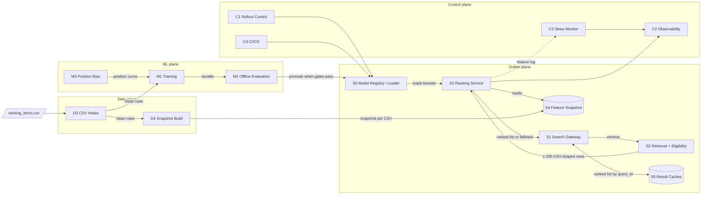
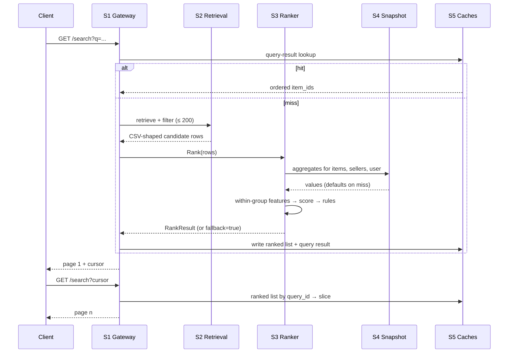

# Architecture: Product Ranking System (marketplace search, LambdaMART v1)

| | |
|---|---|
| Status | Draft v2 for review |
| Owner | Alex Lavrenin |
| Date | 2026-11-12 |
| Spec | [`docs/specs/product-ranking-model.md`](../specs/product-ranking-model.md) (v2) |
| Plan | [`docs/plans/product-ranking-model.dev-plan.md`](../plans/product-ranking-model.dev-plan.md) |
| Review | [`docs/plans/product-ranking-model.interview-review.md`](../plans/product-ranking-model.interview-review.md) |
| Code | `shopfeed/` (library), `scripts/` (CLIs) |

### Changelog

| Version | Change |
|---|---|
| v2 (2026-11-12) | Three scope rules applied (§1): no generated data and no generators; the CSV is the only input; the assignment / exploration router (S7) is removed. Event collection (D1), event store and attribution (D2) and the index updater (D5) are removed with them. Feature set drops from 42 to 38 (§6). New §11 lists the repo changes this implies and §12 the gates that can no longer be read. |
| v1 (2026-11-12) | Initial draft: 19 services, parquet event sources, S7 router. |

This document says **which services exist, what each owns, how they talk, and what they promise**. Section references marked "spec §" point to the spec. The spec and plan still describe the parquet pipeline and the randomised slice; where they disagree with this document, §12 lists the difference.

## 1. Scope rules

| # | Rule | Meaning in this architecture |
|---|---|---|
| 1 | No generated data, no generators | Nothing in the system reads or produces simulated traffic. The simulated feed parquet files, the 195K-row CSV built from them, the synthetic log generator and every artefact or report derived from them are out. |
| 2 | The CSV is the only input | One file with the spec §2 header is the whole data contract. Labels, features and position come from its columns. No event log, no attribution, no joins to other tables. |
| 3 | No router | The ranking system does not assign users to arms and does not randomise positions. It ranks when it is called. Who calls it, and for which users, is the caller's decision. |

In scope: validating the CSV, building features from it, training and evaluating the ranker, serving it with rules, caches, pagination and fallback, and rolling a model forward or back.

Out of scope: candidate generation, eligibility, the search UI, production of the CSV, experiment assignment, exploration traffic.

## 2. Input contract

`ranking_items.csv`, one row per (query, candidate) impression, 21 columns (`shopfeed/schema.py`, spec §2):

```
session_id,qid,query_text,user_id,item_id,device,user_aov_tier,bm25,semantic_sim,price,
hist_ctr_7d,rating,displayed_pos,clicked,added_to_cart,purchased,relevance_grade,
impression_ts,wishlisted,seller_id,category
```

- **Labels** are read as supplied: `relevance_grade` 0–4 and the four binaries. Nothing is reconstructed from events.
- **Group key** is `qid`. **Split key** is `session_id`, ordered by `impression_ts`.
- **Position** is `displayed_pos`. Training and evaluation use it; serving never does.
- **Serving reuses the same shape.** A candidate row sent to the ranker is a CSV row without the label columns and without `displayed_pos`.

The only non-generated file in the repo today is the 10-row fixture (`tests/fixtures/ranking_items.csv`; 2 sessions, 2 query groups). See §12 for what that blocks.

## 3. Architecture drivers

| Driver | Requirement | Consequence |
|---|---|---|
| Latency | Ranking path ≤ 21 ms p99; end-to-end ≤ 50 ms p99; pages 2+ ≤ 10 ms p99 | Rank once per query, cache the list, paginate from cache. GBDT on CPU, 4 scoring threads. |
| Availability | ≥ 99.9% of requests ranked within 50 ms, monthly | Every failure degrades to BM25 / retrieval order. No 5xx. Hard 30 ms timeout. |
| Pagination consistency | 0% duplicates across pages | Opaque cursor = `query_id` + offset; cache-miss path dedups served items. |
| Train–serve parity | Skew < 0.1% of requests | One feature code path for training and serving; per-request feature log recomputed offline. |
| Reproducibility | Same SHA + same CSV reproduces `metrics.json` to 3 decimals | Bundle records SHA, seed, CSV hash, cut timestamps, gain table, feature list. |
| Leakage safety | Aggregates use only rows before the impression | Feature snapshot is built from CSV rows with `impression_ts < t`, minus a label-maturity lag (§6). |
| Position bias | Training corrects for position | LightGBM position metadata from `displayed_pos`. No randomised traffic exists (rule 3). |
| Cache vs personalisation | Only `user_aov_tier` personalises v1 | Query-result cache key = query + device + tier + country + filters. |

## 4. System context



The online plane depends only on a loaded model, the feature snapshot and the caches. Nothing flows from the online plane back into the data plane: the CSV is produced outside this system.

## 5. Service catalogue

Status key: **built** = implemented and tested; **rework** = exists but reads parquet or the randomised log and must be rebuilt on the CSV; **wrap** = library exists, needs a process or shared store; **new** = not in the repo; **ext** = owned elsewhere.

| ID | Service | Owns | Status | Repo |
|---|---|---|---|---|
| S1 | Search Gateway | request lifecycle, `query_id`, cursor, fallback decision, whether to call the ranker | ext | — |
| S2 | Retrieval + Eligibility | ≤ 200 candidates as CSV-shaped rows, eligibility filters | ext | — |
| S3 | Ranking Service | features → score → rules → ranked list; fallback; feature log | built, wrap | `shopfeed/serving/ranker.py`, `rules.py` |
| S4 | Feature Snapshot | item / seller / user / popularity aggregates derived from the CSV | rework | `shopfeed/features/history.py` |
| S5 | Result Caches | ranked-list cache, query-result cache | wrap | `shopfeed/serving/cache.py`, `pagination.py` |
| S6 | Model Registry / Loader | bundles, versions, active + previous, rollback | wrap | `Ranker.load`, `artifacts/ranker_vN/` |
| D3 | CSV Intake | schema, cleaning, readiness gates | built | `shopfeed/schema.py`, `data/clean.py`, `data/checks.py`, `scripts/check_ranking_data.py` |
| D4 | Snapshot Build | builds S4 from clean CSV rows | rework | `shopfeed/features/history.py` |
| M1 | Training Pipeline | split, features, LambdaMART, sweep, bundle | built | `shopfeed/training/`, `scripts/train.py`, `sweep.py` |
| M2 | Offline Evaluation | metrics, CIs, slices, ship gates, baselines | built | `shopfeed/eval/`, `scripts/baselines.py` |
| M3 | Position Bias | position curve from `displayed_pos` | rework | `shopfeed/eval/propensity.py` |
| C1 | Rollout Control | which bundle is active; rollback | new | — |
| C2 | Observability | SLA, fallback, latency, snapshot age, drift | new | `Ranker.counters`, `RankResult.timings_ms` |
| C3 | Skew Monitor | logged features vs recomputed | wrap | `Ranker.request_log` |
| C4 | CI/CD | lint, unit, security; model tests gate promotion | built (3 jobs lose their data, §12) | `.github/workflows/ci.yml` |

Removed in v2:

| ID | Service | Why removed | What replaces it |
|---|---|---|---|
| S7 | Assignment + exploration router | rule 3 | Nothing inside this system. The gateway decides whether to call S3. |
| D1 | Event collection | rule 2 | The CSV already carries the outcome columns. |
| D2 | Event store + attribution | rule 2 | Labels are read from the CSV; no attribution window exists here. |
| D5 | Index + store updater | rule 2 | Price arrives on the candidate row. Query-result cache relies on its 5 min TTL and the deploy flush. |
| — | Parquet → CSV build, AOV tier build | rules 1, 2 | `user_aov_tier` is a CSV column. |
| — | Synthetic log generator | rule 1 | Nothing yet (§12). |

### 5.1 S1 Search Gateway (ext)

Owns the request: mints `query_id`, calls S2 then S3, serves page slices from S5, and serves retrieval order if S3 returns `fallback=true` or misses its 30 ms deadline. It also owns the decision the removed router used to make: **a request either goes to S3 or keeps the incumbent order**. This system does not see or log that decision.

### 5.2 S2 Retrieval + Eligibility (ext)

Returns ≤ 200 candidates, already filtered (stock, shipping, blocked or inactive sellers), **as CSV-shaped rows**: `qid, session_id, user_id, item_id, seller_id, category, device, user_aov_tier, query_text, bm25, semantic_sim, price, hist_ctr_7d, rating, impression_ts`. No duplicates; S3 dedups defensively and counts.

### 5.3 S3 Ranking Service

- **Pipeline** (`Ranker.rank`): dedup → cap 200 → `build_features(rows, snapshot)` → `booster.predict` on 4 threads → `apply_rules` → feature log → timeout check.
- **Rules** (`RuleFlags`): relevance floor on, unpopular demotion on, best-seller boost off. **New-item slot off** until the CSV carries a publish date (§6, ADR-4).
- **Fallback** (`fallback_order`): BM25 descending, then retrieval order. Triggered by any exception, a snapshot failure, or ranking path > 30 ms. Budget 0.1% of requests per day.
- **Feature log**: `{qid, model_version, item_ids, features}` as numpy arrays to a bounded sink; production injects an off-process sink for C3.
- **Process hygiene**: `gc.collect(); gc.freeze()` after load and after each snapshot reload.
- **Interface**: `Rank(rows) → RankResult{item_ids, scores, fallback, reason, timings_ms, model_version}`.

### 5.4 S4 Feature Snapshot

An immutable, in-memory lookup built by D4 from one CSV. Keys: `item_id`, `seller_id`, `user_id`, `category`. It answers "what was known about this key before time `t`" for the derived features in §6. One snapshot per CSV; replicas load it at start and on a new CSV. A missing key returns cold-start defaults, never an error.

Within-group features (rank, z-score, ratio-to-max, group size, group mean and max) are not stored. They depend on the candidate set and are computed in S3.

### 5.5 S5 Result Caches

| Cache | Key | Value | TTL | Invalidation |
|---|---|---|---|---|
| Ranked list | `query_id` | ordered `item_id`s + `model_version` | 30 min | none |
| Query result | `(norm query_text, device, aov_tier, country, filters)` | ordered `item_id`s | 5 min | model deploy flush; `invalidate_items` hook stays available to the gateway |
| Model | version | loaded booster | until deploy | blue/green swap |

Page 1 ranks the whole set once; pages 2+ slice the cached list. On a miss for page ≥ 2: re-rank, drop items already served for that `query_id`, count the event. The ranked-list cache must be shared across replicas; the query-result cache can stay local.

### 5.6 S6 Model Registry / Loader

Bundle (`artifacts/ranker_vN/`): `model.txt`, `features.json`, `propensities.json`, `metrics.json`, `meta.json`, `importance.csv`. `meta.json` records the git SHA, seed, **CSV hash and row count**, split cut timestamps, gain table and params. Replicas hold two boosters, active and previous. Deploy = load, flip, flush the query-result cache. Rollback = flip back, ≤ 5 min, no redeploy.

### 5.7 D3 CSV Intake

`schema.validate` (exact header, dtypes) → `clean.py` (ID formats, categorical normalisation, query-text PII and injection drops, numeric parsing, duplicates; `reports/clean_report.json`; build fails above per-rule drop thresholds) → `checks.py` readiness gates.

Gates that still run on a CSV: header, nulls in keys and labels, feature null rate, label consistency, group size ≥ 2, `displayed_pos` permutation, row and group counts, grade distribution, `impression_ts` present. Gates that cannot run without other sources and are dropped: purchase and wishlist attribution rate, seller and category joins against product tables, point-in-time recomputation of `hist_ctr_7d`.

### 5.8 D4 Snapshot Build

Reads clean rows, sorts by `impression_ts`, and builds the S4 lookup. Runs once per new CSV. Publishes the snapshot with the CSV hash so S3, M1 and C3 can prove they used the same one.

### 5.9 M1 Training Pipeline

```
clean rows ─▶ splits.py (60/20/20 by session start time; cut ts → meta.json)
           ─▶ features/ranking.py + snapshot (38 features, same code as S3)
           ─▶ train_lambdamart.py (lambdarank, label_gain {0,1,2,5,40}, Dataset(position=displayed_pos−1))
           ─▶ sweep.py (validation only; select by Purchase MRR, tie-break NDCG@10)
           ─▶ artifacts/ranker_vN/ ─▶ M2 gates ─▶ S6
```

Retrains when a new CSV arrives. There is no weekly rolling window, because there is no event stream to roll over.

### 5.10 M2 Offline Evaluation

NDCG@k for both gain tables, Purchase MRR, Purchase@k, exposure metrics, 1,000 bootstrap resamples over `qid`, paired deltas against logged order (`displayed_pos`), slices, HTML report. Baselines: logged order, BM25 sort, CTR sort, best-seller sort, semantic sort, pointwise LightGBM.

### 5.11 M3 Position Bias

LightGBM learns the position effect itself from `displayed_pos` passed as position metadata; no external curve is required for training. `propensities.json` holds the observed click rate by position, **labelled observational**: without randomised traffic it mixes position with relevance, so IPW-NDCG computed from it is a diagnostic, not an unbiased estimate (§12).

### 5.12 C1 Rollout Control

Sets the active bundle in S6 and flips to the previous one on rollback. Stop conditions it acts on, read from C2: ranking p99 above budget for 30 min; fallback > 1% for 15 min. Traffic share and arm assignment are not here (rule 3).

### 5.13 C2 Observability

Ranking path p50 / p99 by stage; fallback rate and reason; model availability; ranked-list hit rate on page ≥ 2; pagination duplicates; snapshot age and CSV hash in use; skew rate and feature drift from C3; duplicate candidates from retrieval.

### 5.14 C3 Skew Monitor

Samples the S3 feature log, rebuilds the same rows offline with `build_features` against the same snapshot, and diffs per feature. Reports skew rate and PSI per feature.

### 5.15 C4 CI/CD

Runs today without generated data: lint, unit tests on the 10-row fixture, security (pip-audit, bandit, gitleaks). The integration, e2e and load jobs currently generate their data and are blocked by rule 1 (§12).

## 6. Features under the CSV-only rule

| Source | Features | Count |
|---|---|---|
| CSV column, used directly | `bm25`, `semantic_sim`, `price`, `hist_ctr_7d`, `rating` | 5 |
| CSV column, encoded | `user_aov_tier_code`, `device_code` | 2 |
| Within the candidate set | rank, z-score and ratio-to-max of `bm25`, `semantic_sim`, `price`, `hist_ctr_7d`, `item_purchases_30d`; `candidate_set_size`, group mean and max `semantic_sim` | 18 |
| Derived from earlier CSV rows (S4) | `item_purchases_30d`, `item_purchases_all`, `item_wishlist_30d`, `seller_item_count`, `seller_purchases_30d`, `user_order_count`, `is_new_user`, `user_aov_value`, `price_to_user_aov`, `item_bestseller_rank_category`, `item_bestseller_pct_global`, `is_category_top20`, `is_unpopular` | 13 |
| **Dropped**: needs a table the CSV does not have | `item_age_days` (publish date), `seller_return_rate`, `seller_fulfilment_days` (seller table), `user_follows_seller` (follow events) | −4 |

Total 38, down from 42.

Three limits of deriving history from the CSV, each a design constraint on D4:

- **Label maturity.** The CSV has `impression_ts` but no event times. A purchase on an earlier row may not have happened yet at time `t`. D4 applies a fixed lag before an earlier row's labels count; the value must be set from the real export (ADR-3).
- **Search-only view.** Counts cover only what appears in the CSV. `seller_item_count` is "items seen in search", and purchases outside search are invisible.
- **`hist_ctr_7d` is trusted as supplied.** There is no event source to recompute it from.

## 7. Online request flow



Latency budget, page 1, p99: retrieval 25 ms, feature read 8 ms, transform 2 ms, scoring 8 ms, rules 1 ms, cache write 2 ms. Ranking path ≤ 21 ms.

## 8. Data contracts

| Contract | Owner | Consumer | Where defined |
|---|---|---|---|
| `ranking_items.csv` header | CSV producer (external) | D3, tests | `shopfeed/schema.py` |
| Clean rows | D3 | D4, M1, M2 | same header, cleaned |
| Candidate row | S2 | S3 | CSV columns minus labels and `displayed_pos` |
| Feature snapshot + CSV hash | D4 | S3, M1, C3 | §5.4; names must match `features.json` |
| Bundle | M1 | S6, S3, M2 | spec §7.4 plus CSV hash in `meta.json` |
| `RankResult` | S3 | S1, C2 | `shopfeed/serving/ranker.py` |
| Feature log record | S3 | C3 | `{qid, model_version, item_ids, features}` |

Never in a feature vector: `displayed_pos`, the label columns, raw `session_id` / `qid` / `user_id` / `item_id` / `seller_id`.

## 9. Failure modes and degradation

| Failure | Behaviour |
|---|---|
| Model exception | BM25 → retrieval order, `fallback=true` |
| Ranking path > 30 ms | fallback order |
| Snapshot key missing | cold-start defaults; not a fallback |
| Snapshot unavailable | fallback order |
| Ranked-list miss, page ≥ 2 | re-rank, dedup served items, count |
| Shared cache down | rank uncached with dedup |
| Bad model promoted | C1 flips S6 to previous, ≤ 5 min |
| CSV fails intake | no snapshot, no training; S3 keeps the current snapshot and model |

None of these returns a 5xx from the ranking path.

## 10. Decisions and ADR candidates

Decided:

| # | Decision | Why |
|---|---|---|
| 1 | In-process GBDT, no model server | Sub-millisecond scoring; a network hop costs more than the model. |
| 2 | Rank once, paginate from cache | The 0% duplicate gate cannot be met by per-page re-ranking. |
| 3 | One feature code path for train and serve | Skew gate 0.1%. |
| 4 | Candidate row is CSV-shaped | One contract for training input and serving input; no feature fetch for the directly supplied columns. |
| 5 | No router in the ranking system | Rule 3. Assignment belongs to the caller. |
| 6 | Position bias through LightGBM position metadata only | No randomised traffic; the learned position component is the one method that needs none. |

Open:

| ADR | Question |
|---|---|
| ADR-1 | S3 transport: sidecar RPC vs in-process library inside the search service. |
| ADR-2 | Objective: graded relevance vs purchase-dominant gain. The review argues the brief asks for relevance. |
| ADR-3 | Label-maturity lag for derived history features, given the CSV has no event times. |
| ADR-4 | New items. Without a publish date the new-item slot is off, so unpopular demotion has no exemption. Either add a publish-date column to the CSV or turn unpopular demotion off as well. |
| ADR-5 | `semantic_sim` contract: similarity or distance, and its range. The cleaner currently enforces `[-1, 1]`. |
| ADR-6 | Test data under rule 1 (§12, item 3). |

## 11. Repo changes this architecture implies

Not done. Listed so the removal can be reviewed before anything is deleted. The data, artefact and report folders are untracked locally, so deleting them cannot be undone through git.

| Action | Paths |
|---|---|
| Delete: generators | `shopfeed/testing/synth.py`, `shopfeed/testing/__init__.py` |
| Delete: generated data (untracked) | `data/*.parquet`, `data/ranking_items.csv` (195K rows built from the simulated feed), `data/aov_tiers.json`, `data/meta.json` |
| Delete: outputs derived from generated data (untracked) | `artifacts/ranker_v2/`, `artifacts/ranker_v1/`, `reports/*` |
| Delete: parquet path | `shopfeed/data/build.py`, `shopfeed/data/aov.py`, `scripts/build_ranking_dataset.py`, `scripts/build_user_aov.py`, `tests/test_build.py`, `tests/test_aov.py` |
| Rework on CSV rows | `shopfeed/features/history.py`, `shopfeed/data/checks.py`, `shopfeed/training/dataset.py`, `shopfeed/eval/propensity.py`, `shopfeed/serving/ranker.py`, `shopfeed/serving/rules.py` (new-item slot), `scripts/check_ranking_data.py`, `scripts/bench_serving.py`, `shopfeed/config.py` (attribution constants) |
| Rework or remove: tests that generate data | `tests/conftest.py`, `tests/integration/`, `tests/e2e/`, `tests/load/`, and the matching jobs in `.github/workflows/ci.yml` |
| Keep | `tests/fixtures/ranking_items.csv` (10 rows, 21 columns), `data/ranking_items.v1_fixture.csv` (original 17 columns) |

## 12. What these rules block

1. **There is no data to train on.** The only non-generated CSV has 10 rows and 2 query groups. It cannot fill a 60/20/20 time split or a 500-row leaf, and logged order already scores NDCG@10 0.997 on it, so the +2% ship gate is arithmetically unreachable. Training, the sweep and every offline number wait for a real CSV export.
2. **Two spec ship gates cannot be read.** "NDCG@10 on randomised slice" and unbiased IPW-NDCG both need randomised traffic, which rule 3 removes. The spec needs an edit: drop the gate, or accept the observational diagnostic in its place.
3. **Three CI jobs have no data.** Integration, e2e and load run on a generated log. Options: commit a real CSV sample large enough to drive them, or allow generated rows in tests only. Until then, CI coverage is lint, unit and security.
4. **The online experiment has no home in this system.** The spec still requires an A/B with a rollout ladder. With no router here, the search platform must own assignment, arm logging and the readout.
5. **Spec, plan and A/B plan are out of date.** They describe the parquet build, attribution windows, the 42-feature model, the randomised slice and `ranker_v2` results from generated data.

## 13. Build-out phases

| Phase | Deliverable | Unblocks |
|---|---|---|
| P0 | Remove generators and the parquet path (§11); CI green on lint, unit, security | a repo that matches rules 1 and 2 |
| P1 | D4 and S4 rebuilt on CSV rows; 38-feature builder; M3 on `displayed_pos`; unit tests on the fixture | training on any CSV |
| P2 | Real CSV export received; D3 gates pass; M1, sweep, M2 produce the first valid bundle | a model worth serving |
| P3 | S3 as a service with off-process feature log; shared ranked-list cache; S6 two-booster swap and rollback test | serving and rollback gates |
| P4 | C1, C2, C3 jobs and alerts | operating it |
